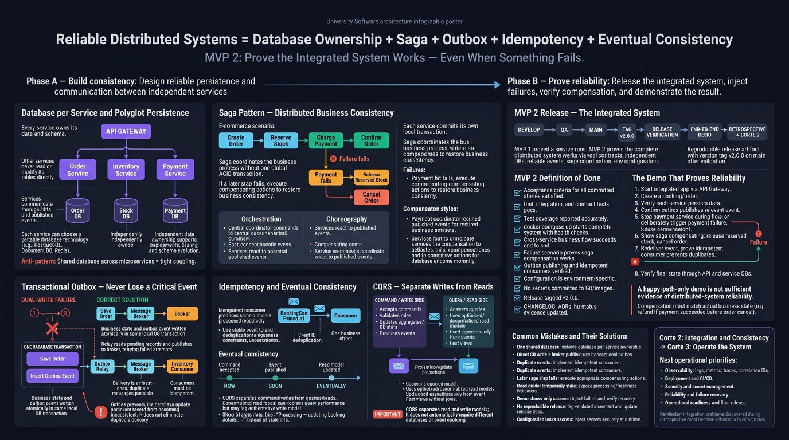

<!-- HU-STATUS TEMPLATE - do NOT remove the <!-- ... --> markers or the table headers.
     Your weekly grade is read AUTOMATICALLY from this file:
       10-week/hu-status/README.md  (inside YOUR fork). English. -->

# Weekly Status - Week 10

<!-- CONFIG-START - must match your profile repo (username/username) CONFIG -->
- FULL_NAME: Yeferson Esmid Heredia Perdomo
- GITHUB_USER: Yefersom10
- TEAM: CineSync Platform
- SPRINT_GOAL: Deliver the Booking vertical of Cut 2 (hold, expiration, confirmation, outbox relay and real-API frontend) through develop -> qa -> main and close release/2.0.0 in the four Booking repositories.
<!-- CONFIG-END -->

## 1. User stories worked this week
| HU ID | Title | Status (todo/doing/done) | Evidence (PR or commit URL) |
|---|---|---|---|
| HU-BOOKING-001 | Client Creates a Temporary Seat Hold | done | https://github.com/code-corhuila/csp-booking-api/issues/8 · api PRs [#23](https://github.com/code-corhuila/csp-booking-api/pull/23), [#27](https://github.com/code-corhuila/csp-booking-api/pull/27), [#28](https://github.com/code-corhuila/csp-booking-api/pull/28) · db [#15](https://github.com/code-corhuila/csp-booking-db/pull/15) · main: [api#54](https://github.com/code-corhuila/csp-booking-api/pull/54), [db#37](https://github.com/code-corhuila/csp-booking-db/pull/37) |
| HU-BOOKING-002 | Expired Hold Releases Seats | done | https://github.com/code-corhuila/csp-booking-api/issues/9 · [api#29](https://github.com/code-corhuila/csp-booking-api/pull/29) · [worker#2](https://github.com/code-corhuila/csp-worker/pull/2) · main: [worker#17](https://github.com/code-corhuila/csp-worker/pull/17) |
| HU-BOOKING-003 | Client Confirms a Reservation | done | https://github.com/code-corhuila/csp-booking-api/issues/10 · [api#38](https://github.com/code-corhuila/csp-booking-api/pull/38) · [api#40](https://github.com/code-corhuila/csp-booking-api/pull/40) · [docs#100](https://github.com/code-corhuila/csp-docs/pull/100) |
| HU-FE-BOOKING-001 | Frontend Booking Integrates the Real Booking API | done | https://github.com/code-corhuila/csp-booking-portal/issues/10 · portal PRs [#23](https://github.com/code-corhuila/csp-booking-portal/pull/23), [#24](https://github.com/code-corhuila/csp-booking-portal/pull/24), [#25](https://github.com/code-corhuila/csp-booking-portal/pull/25) · main: [portal#53](https://github.com/code-corhuila/csp-booking-portal/pull/53) |
| csp-booking-portal#38 | Admin section with sample reservations | done | https://github.com/code-corhuila/csp-booking-portal/pull/39 · https://github.com/code-corhuila/csp-booking-portal/pull/45 |
| csp-booking-portal#30, #31, #35, #18 | CRLF files, demo fallback, Catalog showtimes (Cut 3), boundary lint | todo | https://github.com/code-corhuila/csp-booking-portal/issues/30 |

## 2. My individual contribution
- **Booking database (`csp-booking-db`, Flyway, outbox):**
  - Created the hold, reservation, idempotency and outbox tables (PR [#15](https://github.com/code-corhuila/csp-booking-db/pull/15), promoted in [#19](https://github.com/code-corhuila/csp-booking-db/pull/19)).
  - V010 revokes `DELETE` on the outbox and documents that there is no purge ([#28](https://github.com/code-corhuila/csp-booking-db/pull/28)); V011 ties `seat_hold_item` and `reservation_seat` to their hold with composite keys ([#30](https://github.com/code-corhuila/csp-booking-db/pull/30)); V012 drops the FK that V011 made redundant ([#39](https://github.com/code-corhuila/csp-booking-db/pull/39)); U001 refuses a partial or out-of-order schema drop ([#27](https://github.com/code-corhuila/csp-booking-db/pull/27)).
- **Backend (`csp-booking-api`):** correlation id and RS256 bearer validation (#18), liveness/readiness (#21), transactional persistence and `POST /holds` (#23, #26, #27), reservation reads (#28), internal expiration sweep (#29), confirmation with `BookingConfirmed` (#38), domain error split (#41), `AuthenticatedCaller` port declared by `booking-core` (#44), `hold_id` on each reservation seat (#46), 503 when the database is unreachable (#48), integration tests against PostgreSQL in CI (#32).
- **Worker (`csp-worker`):** scaffold of the three-module Maven project (#1), `expire-holds` job (#2), executable jar and container image (#3), transactional outbox relay with PostgreSQL adapters, RabbitMQ publisher with confirms and scheduler (#7 to #10, promoted in #11 to #14), framework kept out of `worker-core` (#20).
- **Frontend (`csp-booking-portal`):** Dark Cinema Neon scoped theme (#22), checkout and confirmation (#23), seat map and hold creation (#24), seat-conflict handling (#25), sample reservations fallback (#28), admin reservations view and federated `./admin-routes` entry (#39, #45), CORS headers for the container (#47), stylesheet scope guard test (#34).
- **Infrastructure (`csp-infra-postgres`):** single PostgreSQL instance and composition of the booking slice, env file names per Annex J, mandatory environment in `up.sh`/`down.sh` (#1, #3, #6).
- **Documentation (`csp-docs`):** expiration runbook (#97), story status updates (#98, #100, #108, #116), data dictionary for V011 (#102), ADR-014 amendment (#104), admin route, wireframe and `booking:read:all` permission (#105), relay delivery trail (#109), `qa-promote` branching policy (#88).
- **Release:** `release/2.0.0` promoted from qa to main in the four Booking repositories: [db#37](https://github.com/code-corhuila/csp-booking-db/pull/37), [worker#17](https://github.com/code-corhuila/csp-worker/pull/17), [api#54](https://github.com/code-corhuila/csp-booking-api/pull/54), [portal#53](https://github.com/code-corhuila/csp-booking-portal/pull/53). Scaffold promotions of Catalog, Concessions and Ticketing portals to qa/main (5 Oct).
- **Volume:** 356 commits in 9 repositories, full list with URLs in [git_commits.md](./git_commits.md).
- **PR breakdown (132 PRs opened this week):** 56 are my own feature, fix, refactor, test and docs PRs; 76 are promotions to qa/main, changelogs and release merges. Classified by PR title; the own-work group includes 3 scaffold PRs and some closed PRs (e.g. portal #20, #21, #32), and the promotion group includes 9 closed ones.
- **Ceremonies:** defined in `csp-docs/00-governance/agile-conventions.md`; no planning, daily, review or retro minutes were recorded this week. Flow is covered by per-environment PRs (develop -> qa -> main).

## 3. Blockers and risks
- No local PostgreSQL (application control policy): integration tests run in CI or Docker containers, and Docker Desktop shuts down on its own.
- There is no gateway yet: the portal has no path to the API (no CORS or configured `csp-api-gateway`); it was verified against the real platform through a temporary proxy.
- 10 portal files have committed CRLF line endings ([#30](https://github.com/code-corhuila/csp-booking-portal/issues/30)); the 400-line PR rule penalizes editing them.
- The 400-line exemption used in the PRs to main has no normative source; pending confirmation from the team lead.
- The `booking_writer` role still holds `UPDATE` on the outbox (V013 pending).
- Outbox relay is off by default, the `cine.events` exchange is assumed, it runs as a single instance without a lock, and ADR-019 carries a discovery query that can stall ([docs#106](https://github.com/code-corhuila/csp-docs/issues/106)).
- Every push to a PR discards the bot approval and opens another review round (20 to 60 min).
- Dependencies on other teams: nginx healthcheck over IPv6, `csp-infra-postgres` not yet promoted to main, `csp-booking-db#25` and `#26` wait for infra, Ticketing PDF has no agreed location.

## 4. Plan for next week
- Observability of the relay: readiness, metrics and alerts (ADR-014), single-instance lock, Grafana/Prometheus dashboards.
- Operations: V013 (remove `UPDATE` on the outbox), decide the outbox purge, write `events.md` with the exchange, enable the relay in `qa` once consumers are ready.
- Close the cycle: notify the lead about release 2.0.0, get the source of the 400-line exemption, promote `csp-infra-postgres` to main, agree the gateway with Oscar's team.
- Portal: replace synthetic functions with the Catalog response (#35), decide the demo fallback (#31), boundary lint (#18), normalize CRLF (#30).
- Send the pending messages (gateway, CORS ADR-026, nginx healthcheck, `db#25/#26`, relay, Ticketing PDF) and clean up local worktrees.

## 5. Compliance self-check
- [x] Conventional Commits - `type(scope): summary`
- [x] Per-environment HU branch + PR to that environment (hu-xxx-dev -> develop, ...)
- [x] Testable acceptance criteria
- [x] Tests added/updated (unit / integration)
- [x] DDD / hexagonal boundaries respected (domain has no I/O)
- [x] No secrets; config via environment variables

## 6. Evidence links

- Full commit list of the week: [git_commits.md](./git_commits.md)
- Release 2.0.0 to main: https://github.com/code-corhuila/csp-booking-api/pull/54 · https://github.com/code-corhuila/csp-booking-db/pull/37 · https://github.com/code-corhuila/csp-worker/pull/17 · https://github.com/code-corhuila/csp-booking-portal/pull/53
- Story status in docs: https://github.com/code-corhuila/csp-docs/pull/116
- Outbox relay (worker): https://github.com/code-corhuila/csp-worker/pull/7 · https://github.com/code-corhuila/csp-worker/pull/10
- Admin federated entry: https://github.com/code-corhuila/csp-booking-portal/pull/45
- Repositories: https://github.com/code-corhuila/csp-booking-api · https://github.com/code-corhuila/csp-booking-db · https://github.com/code-corhuila/csp-booking-portal · https://github.com/code-corhuila/csp-worker · https://github.com/code-corhuila/csp-docs · https://github.com/code-corhuila/csp-infra-postgres
- Class Material - Persistence in Distributed Systems (Saga, Outbox, CQRS):

