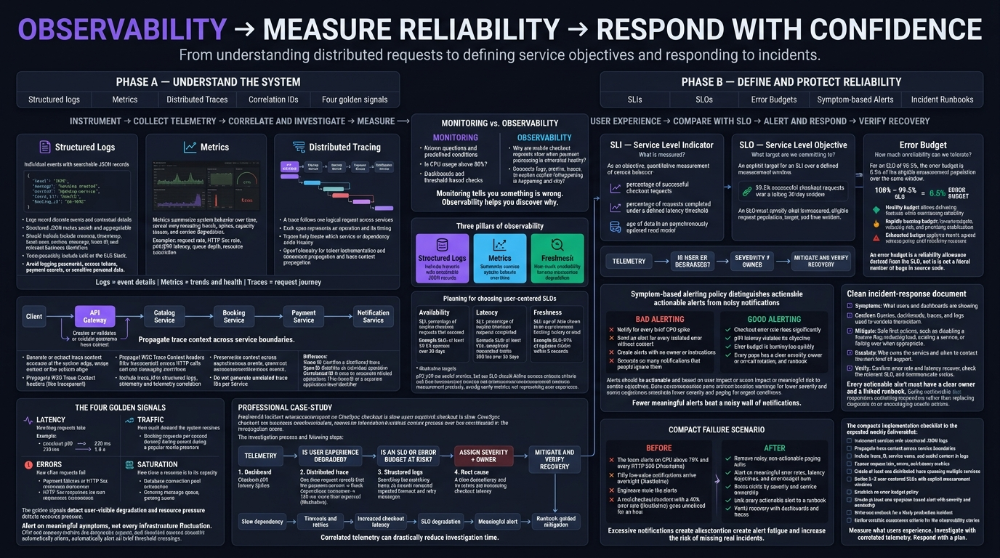

<!-- HU-STATUS TEMPLATE - do NOT remove the <!-- ... --> markers or the table headers.
     Your weekly grade is read AUTOMATICALLY from this file:
       11-week/hu-status/README.md  (inside YOUR fork). English. -->

# Weekly Status - Week 11

<!-- CONFIG-START - must match your profile repo (username/username) CONFIG -->
- FULL_NAME: Yeferson Esmid Heredia Perdomo
- GITHUB_USER: Yefersom10
- TEAM: CineSync Platform
- SPRINT_GOAL: Keep the released Booking vertical (v2.0.0) demonstrable: rehearse the platform demo runbook, fix the portal container healthcheck, record the promotional video, and complete the project-control, operations, quality and training documentation in csp-docs.
<!-- CONFIG-END -->

## 1. User stories worked this week
| HU ID | Title | Status (todo/doing/done) | Evidence (PR or commit URL) |
|---|---|---|---|
| HU-BOOKING-001, 002, 003 | Seat hold, hold expiration, reservation confirmation | done | No change this week; already Done (DoD) on main since release 2.0.0 (https://github.com/code-corhuila/csp-booking-api/issues/8) |
| HU-FE-BOOKING-001 | Frontend Booking Integrates the Real Booking API | done | No change this week; Done (DoD) on main (https://github.com/code-corhuila/csp-booking-portal/issues/10) |
| csp-booking-portal#54 | Portal container healthcheck resolves `localhost` to `::1` | doing | Issue https://github.com/code-corhuila/csp-booking-portal/issues/54 · PR (open, approved, CI green) https://github.com/code-corhuila/csp-booking-portal/pull/55 |
| csp-booking-portal#56 | Visible portal text in Spanish | todo | https://github.com/code-corhuila/csp-booking-portal/issues/56 |
| Demo runbook | Rehearsed demo runbook of the platform | done | https://github.com/code-corhuila/csp-docs/pull/121 |
| Video record | Record of the promotional video | done | https://github.com/code-corhuila/csp-docs/pull/127 |

## 2. My individual contribution
- **Deployment (portal):** the container healthcheck now checks `127.0.0.1` instead of `localhost`, which nginx resolved to `::1` ([csp-booking-portal#55](https://github.com/code-corhuila/csp-booking-portal/pull/55), 9 lines added and 2 removed), with a CHANGELOG note under `Unreleased`. The PR is approved and its CI passed on 2026-10-13; it is not merged yet.
- **Booking documentation:** rehearsed demo runbook with what it does not cover and what was not observed ([csp-docs#121](https://github.com/code-corhuila/csp-docs/pull/121), 64 lines), linked to its stories and ADR.
- **Training documentation:** record of the promotional video and the source of its music ([csp-docs#127](https://github.com/code-corhuila/csp-docs/pull/127), 72 lines).
- **Cross-cutting documentation in csp-docs** (merged 2026-10-12 UTC): risk register, open questions, dependencies and technical backlog ([#117](https://github.com/code-corhuila/csp-docs/pull/117)); backup and recovery, observability and incidents bound to the CSP services ([#118](https://github.com/code-corhuila/csp-docs/pull/118)); code review guide and testing strategy ([#119](https://github.com/code-corhuila/csp-docs/pull/119)); user and administrator manuals and onboarding ([#120](https://github.com/code-corhuila/csp-docs/pull/120)). They were opened on the evening of Sunday 2026-10-11 in Colombian time (UTC-5), so they fall on Monday in UTC and were not counted in Week 10.
- **PR breakdown (7 PRs opened this week):** all 7 are my own docs and fix PRs; there are no promotions, changelogs or release merges. 6 merged and 1 open (#55). If #117 to #120 are assigned to Week 10 by local time, 3 remain in this week.
- **No code changes** this week in `csp-booking-api`, `csp-booking-db` or `csp-worker`; the work was operations and documentation.
- **Volume:** 8 commits authored by me, listed with URLs in [git_commits.md](./git_commits.md).

## 3. Blockers and risks
- **GitHub Actions is blocked by a billing lock.** A failed `csp-worker` job (run 38791990822) reports "your account is locked due to a billing issue"; the first failure I found is from 2026-10-14 22:47 UTC. The CI of PR #55 passed on 2026-10-13, before the lock, but if its branch is updated the CI would fail for the same reason (inference, not observed). I could not confirm the cause of the 37 `startup_failure` runs in `csp-docs`.
- PR #55 is approved but not merged, and issue #56 (Spanish text) has no PR yet.
- No planning, daily, review or retro minutes exist for this week, so the ceremonies cannot be evidenced.
- Pending from earlier weeks: V013 (remove `UPDATE` on the outbox), the source of the 400-line exemption, `csp-infra-postgres` not yet promoted to main, and messages to other teams not sent.

## 4. Plan for next week
- Merge PR #55 once it can be updated and validated while Actions is locked, and close issue #54.
- Open the PR for issue #56 (visible portal text in Spanish).
- Resolve the pending operations items: V013, outbox purge decision and the `events.md` exchange.
- Record real ceremony minutes (planning, review, retro) in `csp-docs` so the next report can evidence them.
- Observability: no class deliverable exists yet; the observability section of csp-docs#118 is the base to turn the logs, metrics and traces topic into testable stories.

## 5. Compliance self-check
- [x] Conventional Commits - `type(scope): summary`
- [x] Per-environment HU branch + PR to that environment (hu-xxx-dev -> develop, ...)
- [x] Testable acceptance criteria
- [ ] Tests added/updated (unit / integration)
- [x] DDD / hexagonal boundaries respected (domain has no I/O)
- [x] No secrets; config via environment variables

## 6. Evidence links
- Full commit list of the week: [git_commits.md](./git_commits.md)
- Portal healthcheck fix (open): https://github.com/code-corhuila/csp-booking-portal/pull/55
- Demo runbook: https://github.com/code-corhuila/csp-docs/pull/121
- Promotional video record: https://github.com/code-corhuila/csp-docs/pull/127
- Operations, quality and training documentation: https://github.com/code-corhuila/csp-docs/pull/117 · https://github.com/code-corhuila/csp-docs/pull/118 · https://github.com/code-corhuila/csp-docs/pull/119 · https://github.com/code-corhuila/csp-docs/pull/120
- Repositories: https://github.com/code-corhuila/csp-docs · https://github.com/code-corhuila/csp-booking-portal
- Class Material - Observability (logs, metrics and distributed tracing):

