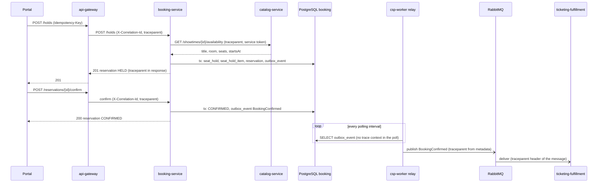

# CP1 - Critical journey and trace map

Journey: a client holds seats for a showtime, confirms the reservation, and the confirmation
reaches Ticketing & Fulfillment through RabbitMQ.

Sources in `csp-docs`: `09-microservices/services/04-booking-service/` (README, events,
data-model, decisions DEC-002, DEC-003, DEC-006) and `07-api/contracts/openapi/booking-service.yaml`.

Current state: the docs define `X-Correlation-Id` (Gateway creates or propagates it) and
`metadata.correlationId` in the event envelope. They do not define `traceparent` yet. Here I
propose it, next to the correlation id.

## Hops

| # | Calls | Receives | Protocol | Operation | Sync/Async | Data touched |
|---|---|---|---|---|---|---|
| 1 | Portal / client | api-gateway | REST | `POST /api/v1/booking/holds` with `Idempotency-Key` | sync | none |
| 2 | api-gateway | booking-service (8083) | REST | `POST /holds` | sync | none |
| 3 | booking-service | catalog-service | REST | `GET /showtimes/{showtimeId}/availability` (DEC-006) | sync | Catalog (MongoDB) |
| 4 | booking-service | PostgreSQL `booking` | JDBC | one transaction: `seat_hold`, `seat_hold_item`, `reservation`, `idempotency_key`, `outbox_event` (`ReservationHeld`) | sync | booking schema |
| 5 | Portal / client | api-gateway, then booking-service | REST | `POST /reservations/{reservationId}/confirm` | sync | `reservation`, `seat_hold_item`, `outbox_event` (`BookingConfirmed`) |
| 6 | csp-worker relay | PostgreSQL `booking` | JDBC | `SELECT` on `booking.outbox_event` with role `booking_outbox_reader` (DEC-003) | async (polling) | read only |
| 7 | csp-worker relay | RabbitMQ | AMQP | publish `cine.booking.booking-confirmed.v1` | async | broker |
| 8 | ticketing-fulfillment-service | RabbitMQ | AMQP | consume `BookingConfirmed` (Inbox deduplicates by `eventId`) | async | ticketing schema |

## Sequence diagram



Trace context on each arrow:

| Arrow | Context that travels |
|---|---|
| Portal to gateway | none yet; the gateway creates `traceparent` and `X-Correlation-Id` |
| Gateway to booking, booking to catalog | HTTP header `traceparent: 00-<trace_id>-<span_id>-01` plus `X-Correlation-Id` |
| booking to PostgreSQL | no header; the trace id is stored in `outbox_event.payload.metadata.traceparent` (proposed) |
| relay to RabbitMQ and to ticketing | AMQP message header `traceparent`, copied from the stored metadata |

The async hop breaks the chain unless the trace id is stored with the event. That is why the
outbox row must carry it.

## Span tree

One `trace_id` for the whole confirmation; durations are targets, not measurements.

```text
trace_id 4bf92f3577b34da6a3ce929d0e0e4736
- gateway: POST /holds                         (root span, 180 ms)
  - booking-service: POST /holds               (server span, 160 ms)
    - catalog-service: GET availability        (client span, 60 ms)
    - postgres: tx create hold                 (client span, 35 ms)
- gateway: POST /reservations/{id}/confirm     (root span, 70 ms)
  - booking-service: confirm                   (server span, 55 ms)
    - postgres: tx confirm + outbox insert     (client span, 25 ms)
- csp-worker: relay publish BookingConfirmed   (producer span, same trace_id, link to confirm)
  - ticketing-fulfillment: consume BookingConfirmed  (consumer span, same trace_id)
    - postgres: inbox insert + ticket          (client span)
```

The producer and consumer spans cross the asynchronous boundary and keep the same
`trace_id`, read from the `traceparent` header of the message.
