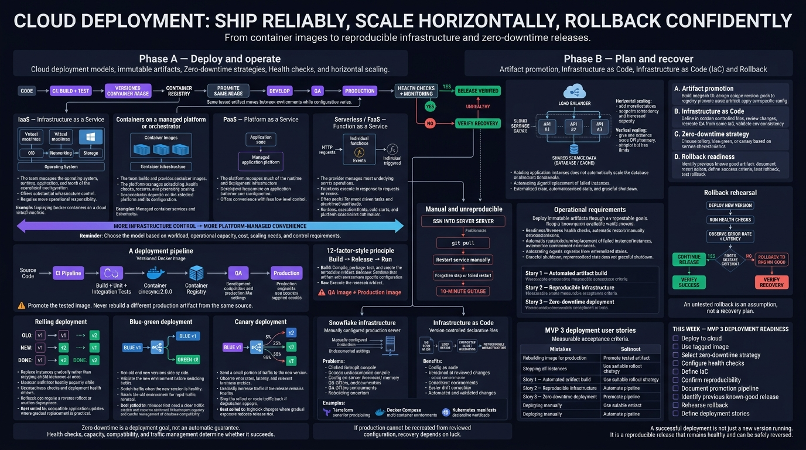

<!-- HU-STATUS TEMPLATE - do NOT remove the <!-- ... --> markers or the table headers.
     Your weekly grade is read AUTOMATICALLY from this file:
       12-week/hu-status/README.md  (inside YOUR fork). English. -->

# Weekly Status - Week 12

<!-- CONFIG-START - must match your profile repo (username/username) CONFIG -->
- FULL_NAME: Yeferson Esmid Heredia Perdomo
- GITHUB_USER: Yefersom10
- TEAM: CineSync Platform
- SPRINT_GOAL: Open the Concessions domain (HU-CONCESSIONS-001 to 004 and 007 across API, database and worker), connect Booking to Catalog for the seat map (HU-CATALOG-005), harden the Booking workflow routes and token checks, translate and normalize the Booking portal, and keep the 3.0.0 releases of Booking and Concessions ready for approval.
<!-- CONFIG-END -->

## 1. User stories worked this week
| HU ID | Title | Status (todo/doing/done) | Evidence (PR or commit URL) |
|---|---|---|---|
| HU-CONCESSIONS-001 | Products | doing | Story [csp-docs#200](https://github.com/code-corhuila/csp-docs/issues/200) (In Review, QA) · api [#10](https://github.com/code-corhuila/csp-concessions-api/pull/10) to [#14](https://github.com/code-corhuila/csp-concessions-api/pull/14) · db [#1](https://github.com/code-corhuila/csp-concessions-db/pull/1), [#2](https://github.com/code-corhuila/csp-concessions-db/pull/2) |
| HU-CONCESSIONS-002 | Combos | doing | Story [csp-docs#201](https://github.com/code-corhuila/csp-docs/issues/201) (In Review, QA) · api [#21](https://github.com/code-corhuila/csp-concessions-api/pull/21) to [#23](https://github.com/code-corhuila/csp-concessions-api/pull/23) · db [#5](https://github.com/code-corhuila/csp-concessions-db/pull/5) |
| HU-CONCESSIONS-003 | Stock | doing | Story [csp-docs#202](https://github.com/code-corhuila/csp-docs/issues/202) (In Review, QA) · api [#28](https://github.com/code-corhuila/csp-concessions-api/pull/28), [#29](https://github.com/code-corhuila/csp-concessions-api/pull/29) · db [#8](https://github.com/code-corhuila/csp-concessions-db/pull/8) |
| HU-CONCESSIONS-004 | Orders | doing | Story [csp-docs#203](https://github.com/code-corhuila/csp-docs/issues/203) (In Review, Dev) · api [#32](https://github.com/code-corhuila/csp-concessions-api/pull/32) to [#35](https://github.com/code-corhuila/csp-concessions-api/pull/35) · db [#10](https://github.com/code-corhuila/csp-concessions-db/pull/10) · worker [#37](https://github.com/code-corhuila/csp-worker/pull/37) to [#40](https://github.com/code-corhuila/csp-worker/pull/40) |
| HU-CONCESSIONS-007 | Stock movement history | doing | Story [csp-docs#207](https://github.com/code-corhuila/csp-docs/issues/207) (In Review, Dev) · api [#38](https://github.com/code-corhuila/csp-concessions-api/pull/38) |
| HU-CATALOG-005 | Booking validates seats against Catalog | doing | Story [csp-docs#193](https://github.com/code-corhuila/csp-docs/issues/193) (In Review, QA) · booking-api [#63](https://github.com/code-corhuila/csp-booking-api/pull/63), [#64](https://github.com/code-corhuila/csp-booking-api/pull/64) · portal [#80](https://github.com/code-corhuila/csp-booking-portal/pull/80) |
| csp-booking-portal#56 | Visible portal text in Spanish | done | Issue [#56](https://github.com/code-corhuila/csp-booking-portal/issues/56) closed 2026-10-20 · PRs [#59](https://github.com/code-corhuila/csp-booking-portal/pull/59), [#62](https://github.com/code-corhuila/csp-booking-portal/pull/62) (promoted in #65, #67) |
| csp-booking-portal#54 | Portal container healthcheck on `127.0.0.1` | done | PR [#55](https://github.com/code-corhuila/csp-booking-portal/pull/55) merged 2026-10-19 |
| Token fix (permissions and clock skew) | Booking and Concessions token validation | done | [csp-booking-api#68](https://github.com/code-corhuila/csp-booking-api/pull/68) · [csp-concessions-api#37](https://github.com/code-corhuila/csp-concessions-api/pull/37) |
| HU-BOOKING-001, 002, 003 and HU-FE-BOOKING-001 | Booking vertical of release 2.0.0 | done | No change this week; Done (DoD) on main ([csp-docs#196](https://github.com/code-corhuila/csp-docs/issues/196) to [#199](https://github.com/code-corhuila/csp-docs/issues/199)) |

## 2. My individual contribution
- **Concessions (new domain for me since 2026-10-19):** base structure and RS256 authentication with the error envelope ([api#8](https://github.com/code-corhuila/csp-concessions-api/pull/8), [#9](https://github.com/code-corhuila/csp-concessions-api/pull/9)); HU-CONCESSIONS-001 to 004 and 007 end to end: domain, JDBC persistence with idempotency, HTTP routes behind the administrator permission, image and CI, and the schema and roles in `csp-concessions-db` (#1, #2, #5, #8, #10: foreign keys, stock movement table, orders, stock reservations and outbox). Promotions to qa of each layer and release 3.0.0 ([api#27](https://github.com/code-corhuila/csp-concessions-api/pull/27), [db#7](https://github.com/code-corhuila/csp-concessions-db/pull/7)).
- **Worker:** four jobs for HU-CONCESSIONS-004: settle the order of a reservation ([#37](https://github.com/code-corhuila/csp-worker/pull/37)), compose the reservation events on the Concessions queues ([#38](https://github.com/code-corhuila/csp-worker/pull/38)), sweep overdue orders ([#39](https://github.com/code-corhuila/csp-worker/pull/39)) and relay the Concessions outbox behind its own flag ([#40](https://github.com/code-corhuila/csp-worker/pull/40)).
- **Booking backend:** internal routes for the workflow service: service subjects split from maintenance ones, internal hold, confirm and release ([api#56](https://github.com/code-corhuila/csp-booking-api/pull/56), [#57](https://github.com/code-corhuila/csp-booking-api/pull/57), [#58](https://github.com/code-corhuila/csp-booking-api/pull/58)); Catalog client and the seat map route of a showtime ([#63](https://github.com/code-corhuila/csp-booking-api/pull/63), [#64](https://github.com/code-corhuila/csp-booking-api/pull/64)); token permission check and clock-skew tolerance ([#68](https://github.com/code-corhuila/csp-booking-api/pull/68)); schema pinned to the `v2.0.0` tag ([#55](https://github.com/code-corhuila/csp-booking-api/pull/55)); README on how a schema version is cut and consumed ([db#41](https://github.com/code-corhuila/csp-booking-db/pull/41)). Release 3.0.0 PRs for api, db and portal ([api#61](https://github.com/code-corhuila/csp-booking-api/pull/61), [db#43](https://github.com/code-corhuila/csp-booking-db/pull/43), [portal#78](https://github.com/code-corhuila/csp-booking-portal/pull/78)).
- **Booking portal:** Spanish text ([#59](https://github.com/code-corhuila/csp-booking-portal/pull/59), [#62](https://github.com/code-corhuila/csp-booking-portal/pull/62)), real seat map ([#80](https://github.com/code-corhuila/csp-booking-portal/pull/80)), boundary lint rule for the shared client ([#58](https://github.com/code-corhuila/csp-booking-portal/pull/58)), LF normalization of seven files and a rule to keep LF ([#60](https://github.com/code-corhuila/csp-booking-portal/pull/60), [#61](https://github.com/code-corhuila/csp-booking-portal/pull/61), #68 to #71, [#76](https://github.com/code-corhuila/csp-booking-portal/pull/76)), healthcheck fix ([#55](https://github.com/code-corhuila/csp-booking-portal/pull/55)).
- **Gateway:** route of the Booking client operations to `csp-booking-api` ([csp-api-gateway#12](https://github.com/code-corhuila/csp-api-gateway/pull/12) and its promotion).
- **Documentation in csp-docs (35 PRs):** ADR-035 (internal Booking operations for the workflow), my registration as a Concessions participant ([#157](https://github.com/code-corhuila/csp-docs/pull/157), [#159](https://github.com/code-corhuila/csp-docs/pull/159)), Concessions contracts 2.2 to 2.4 with ADR-043 and ADR-045, delivery trail and status of each story, and upkeep of the project folders (risks and debt TD-036 and TD-039, Concessions runbook and signals, testing strategy, manuals, seat map route).
- **PR breakdown (120 PRs created):** 82 are my own feature, fix, refactor, test and docs PRs; 38 are promotions to qa, changelogs and release PRs. 115 merged, 5 open (the 3.0.0 releases) and 0 closed without merging. Classified by title; docs PRs that record a promotion trail count as own work.
- **Volume:** 288 commits in 8 repositories, listed with URLs in [git_commits.md](./git_commits.md). The report was cut on 2026-10-25 (last commit 2026-10-25 00:46 UTC), before the end of the week.
- **Ceremonies:** no planning, daily, review or retro minutes exist for this week, and there is no record of the delivery 2 session. Closest material is the release policy [csp-docs#255](https://github.com/code-corhuila/csp-docs/issues/255) and the per-story delivery trail PRs.

## 3. Blockers and risks
- **GitHub Actions is still locked by billing.** The latest job checked (csp-concessions-api, run 40146585091, 2026-10-25 00:24 UTC) reports "your account is locked due to a billing issue". All 117 CI runs of my seven code repositories since 2026-10-19 failed with 0 steps, so CI validated none of my PRs. Validation was local and 115 PRs merged without a green CI. In `csp-docs` there are 100 `startup_failure` runs with no stated cause.
- **The five 3.0.0 release PRs are open, `BLOCKED` with `REVIEW_REQUIRED` and 0 reviews.** Every story validated in qa must be added to those branches until approval ([csp-docs#255](https://github.com/code-corhuila/csp-docs/issues/255)).
- Two Booking technical issues (`csp-booking-api#62`, `csp-booking-portal#79`) are on the board without Status.
- Class sessions 1 and 2 (Cloud deployment): no deliverable of mine exists, and the Compose files still build from source instead of promoting a tagged image.
- Pending from earlier weeks: V013 (remove `UPDATE` on the outbox), the source of the 400-line exemption, `csp-infra-postgres` not yet promoted to main.

## 4. Plan for next week
- Get review and approval for the five 3.0.0 release PRs and keep them current with each story that reaches qa.
- Move HU-CONCESSIONS-001 to 004 and 007 from In Review to Done by promoting to main, and start HU-CONCESSIONS-005 and 006 (Ready).
- Give Status to `csp-booking-api#62` and `csp-booking-portal#79` and close the open Booking technical issues.
- Record real ceremony minutes (planning, review, retro) in `csp-docs`.
- Cloud deployment: write a short deployment note for Booking and Concessions (promotion by tagged image, rollback) so the next report has a deliverable.
- Re-run the activity query to include work done after 2026-10-25 00:46 UTC.

## 5. Compliance self-check
- [x] Conventional Commits - `type(scope): summary`
- [x] Per-environment HU branch + PR to that environment (hu-xxx-dev -> develop, ...)
- [x] Testable acceptance criteria
- [x] Tests added/updated (unit / integration)
- [x] DDD / hexagonal boundaries respected (domain has no I/O)
- [x] No secrets; config via environment variables

## 6. Evidence links
- Full commit list of the week: [git_commits.md](./git_commits.md)
- Booking portal healthcheck merged: https://github.com/code-corhuila/csp-booking-portal/pull/55
- Release 3.0.0 PRs (open): https://github.com/code-corhuila/csp-booking-api/pull/61 · https://github.com/code-corhuila/csp-booking-db/pull/43 · https://github.com/code-corhuila/csp-booking-portal/pull/78 · https://github.com/code-corhuila/csp-concessions-api/pull/27 · https://github.com/code-corhuila/csp-concessions-db/pull/7
- Seat map against Catalog: https://github.com/code-corhuila/csp-booking-api/pull/64 · https://github.com/code-corhuila/csp-booking-portal/pull/80
- Concessions worker jobs: https://github.com/code-corhuila/csp-worker/pull/37 · https://github.com/code-corhuila/csp-worker/pull/40
- Release policy: https://github.com/code-corhuila/csp-docs/issues/255
- Repositories: https://github.com/code-corhuila/csp-docs · https://github.com/code-corhuila/csp-booking-api · https://github.com/code-corhuila/csp-booking-db · https://github.com/code-corhuila/csp-booking-portal · https://github.com/code-corhuila/csp-concessions-api · https://github.com/code-corhuila/csp-concessions-db · https://github.com/code-corhuila/csp-worker · https://github.com/code-corhuila/csp-api-gateway
- Class Material - Cloud deployment (models, strategies and zero-downtime):

