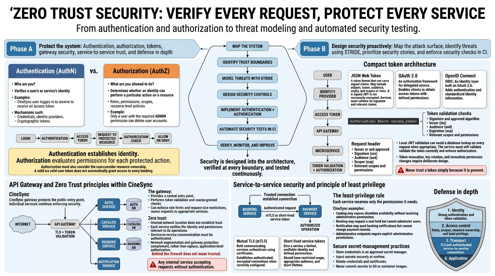

<!-- HU-STATUS TEMPLATE - do NOT remove the <!-- ... --> markers or the table headers.
     Your weekly grade is read AUTOMATICALLY from this file:
       13-week/hu-status/README.md  (inside YOUR fork). English. -->

# Weekly Status - Week 13

<!-- CONFIG-START - must match your profile repo (username/username) CONFIG -->
- FULL_NAME: Yeferson Esmid Heredia Perdomo
- GITHUB_USER: Yefersom10
- TEAM: CineSync Platform
- SPRINT_GOAL: Threat model the boundary API Gateway to Booking service and turn the top threats into security stories and pipeline gates.
<!-- CONFIG-END -->

## 1. User stories worked this week
| HU ID | Title | Status (todo/doing/done) | Evidence (PR or commit URL) |
|---|---|---|---|
| Threat model | STRIDE of the boundary API Gateway to Booking service | done |  PR [csp-docs#277](https://github.com/code-corhuila/csp-docs/pull/277) (open, reviewed by three teammates), claim issue [#274](https://github.com/code-corhuila/csp-docs/issues/274) |
| [security] D | One user cannot hold unlimited seats of a showtime (risk 9, P0) | todo | [csp-docs#283](https://github.com/code-corhuila/csp-docs/issues/283) |
| [security] S | A stolen or revoked access token stops working quickly (risk 4, P2) | todo | [csp-docs#284](https://github.com/code-corhuila/csp-docs/issues/284) |
| [security] E | Internal workflow routes accept only genuine service tokens (risk 6, P1) | todo | [csp-docs#285](https://github.com/code-corhuila/csp-docs/issues/285) |
| HU-CATALOG-005 | Booking refuses seats that are not in the Catalog layout | doing | PR [csp-booking-api#71](https://github.com/code-corhuila/csp-booking-api/pull/71) (open, no review; CI cannot run) |
| Platform compose | Catalog settings in the Booking platform compose | done | PR [csp-booking-api#70](https://github.com/code-corhuila/csp-booking-api/pull/70) (merged 2026-10-29) |
| HU-CONCESSIONS-003, 004 | Documentation closure of the stories | done | [csp-docs#300](https://github.com/code-corhuila/csp-docs/pull/300), [csp-docs#315](https://github.com/code-corhuila/csp-docs/pull/315) (merged) · promotion to qa [csp-concessions-db#11](https://github.com/code-corhuila/csp-concessions-db/pull/11) (open) |

## 2. My individual contribution
- CP0: claimed the boundary and created the workshop folder ([ecf9372](https://github.com/Yefersom10/sistemas-distribuidos-2026-b-g1/commit/ecf9372)).
- CP1: attack surface map with trust boundaries TB1 to TB8, assets and entry points ([7f8dad7](https://github.com/Yefersom10/sistemas-distribuidos-2026-b-g1/commit/7f8dad7)).
- CP2: STRIDE analysis in two pushes, six threats ranked by risk, with the library book Maiorano, *Criptografia: tecnicas de desarrollo para profesionales*, pp. 31-32 ([8cfc556](https://github.com/code-corhuila/csp-docs/commit/8cfc556), [541f407](https://github.com/code-corhuila/csp-docs/commit/541f407)).
- CP3: three security stories with labels and priority, linked in the fork README ([df2b69c](https://github.com/Yefersom10/sistemas-distribuidos-2026-b-g1/commit/df2b69c)).
- CP4: negative test `ForgedWorkflowTokenAuthzTest` (3 tests) and the workflow `security.yml` ([5d94ce0](https://github.com/Yefersom10/sistemas-distribuidos-2026-b-g1/commit/5d94ce0), [9c811a5](https://github.com/Yefersom10/sistemas-distribuidos-2026-b-g1/commit/9c811a5)).
- CP6: answered the three reviews of my PR (Nicolas on row D; Oscar and Karen on row S): the per-`sub` limit moved into Booking, and S was rescored to risk 4 with the 15-minute token of ADR-054 ([f1f95f4](https://github.com/code-corhuila/csp-docs/commit/f1f95f4), [d5c5200](https://github.com/code-corhuila/csp-docs/commit/d5c5200), [reply](https://github.com/code-corhuila/csp-docs/pull/277#issuecomment-6510178764)).
- CP7: refined the backlog: the three issues are in the team board (Backlog), #284 moved to P2 and #285 is related to #287 and #288 ([4103e95](https://github.com/Yefersom10/sistemas-distribuidos-2026-b-g1/commit/4103e95)).
- CP8: ran `ForgedWorkflowTokenAuthzTest` (3 tests, 0 failures) and recorded the output in `HOW-TO-RUN.md` ([d884873](https://github.com/Yefersom10/sistemas-distribuidos-2026-b-g1/commit/d884873)). `security.yml` is valid YAML; `actionlint` was not run.
- Booking and Concessions beyond the workshop: Catalog settings in the platform compose ([csp-booking-api#70](https://github.com/code-corhuila/csp-booking-api/pull/70)), rejection of seats outside the Catalog layout in `POST /holds` and `POST /internal/workflow/holds` ([csp-booking-api#71](https://github.com/code-corhuila/csp-booking-api/pull/71), open), documentation closure of HU-CONCESSIONS-003 and 004 ([csp-docs#300](https://github.com/code-corhuila/csp-docs/pull/300), [csp-docs#315](https://github.com/code-corhuila/csp-docs/pull/315)).
- CP5: review comment on the STRIDE PR of a teammate: [csp-docs#278 review](https://github.com/code-corhuila/csp-docs/pull/278#pullrequestreview-5691725946). I pointed out that `POST /forgot-password` can be used for mail bombing and has no threat row.
- **PR breakdown (6 PRs created in code-corhuila):** 5 are my own security, fix and docs PRs and 1 is a promotion to qa ([csp-concessions-db#11](https://github.com/code-corhuila/csp-concessions-db/pull/11)). 3 merged, 3 open (#277, booking-api#71, concessions-db#11) and 0 closed without merging.
- **Volume:** 20 commits authored by me (2 in `csp-booking-api`, 8 in `csp-docs` including the 4 of the STRIDE branch, 10 in this fork), listed with URLs in [git_commits.md](./git_commits.md). The workshop took place on the evening of Wed 2026-10-28 in Colombia, so its commits are dated 2026-10-29 in UTC. The activity report was cut on 2026-11-01.
- **Ceremonies:** the workshop of 2026-10-28 is evidenced by the claim issue #274, the fork commits `ecf9372` and `03e6f71`, and the peer reviews on #277 and #278; there are no formal minutes. No planning, daily, review or retro minutes exist for this week.

## 3. Blockers and risks
- GitHub Actions is locked by billing (latest checked job: csp-booking-api run 40976326225, 2026-10-29 23:55 UTC, "your account is locked due to a billing issue"), so `security.yml` is a proposal and the test is run locally (CP8). PR #71 has no valid CI and no review, and the three Booking 3.0.0 release PRs (booking-db#43, booking-api#61, booking-portal#78) remain open with `REVIEW_REQUIRED`.
- PR #277 is open with three comment reviews (Oscarsl10, karencaicedo1907, nicolas1250) and no approval; stories #283 to #285 are in Backlog with no code PR yet, so the workshop is not yet translated into code.
- `actionlint` is not installed on my machine and Docker was off, so `security.yml` was only parsed as YAML.

## 4. Plan for next week
- Wait for the merge of PR #277 after the review, and start with story #283 (seat cap per user) in the next sprint.
- Get PR #71 reviewed and merged, and promote the Concessions order schema ([csp-concessions-db#11](https://github.com/code-corhuila/csp-concessions-db/pull/11)).
- Record real ceremony minutes in `csp-docs`, and write a note linking the workshop output to the class topic (authentication, authorization and zero trust), since there are no class session deliverables labelled as such.

## 5. Compliance self-check
- [x] Conventional Commits - `type(scope): summary`
- [ ] Per-environment HU branch + PR to that environment (not applicable: documentation workshop)
- [x] Testable acceptance criteria
- [x] Tests added/updated (unit / integration)
- [ ] DDD / hexagonal boundaries respected (not applicable: no service code changed)
- [x] No secrets; config via environment variables

## 6. Evidence links
- Workshop folder: https://github.com/Yefersom10/sistemas-distribuidos-2026-b-g1/tree/main/13-week/workshop
- STRIDE file: https://github.com/code-corhuila/csp-docs/blob/security/stride-yefersom10/05-architecture/security/stride-yefersom10.md
- Full commit list of the week: [git_commits.md](./git_commits.md)
- Claim issue: https://github.com/code-corhuila/csp-docs/issues/274 · STRIDE PR: https://github.com/code-corhuila/csp-docs/pull/277
- Class Material - Security in distributed systems (authn, authz and zero trust):

