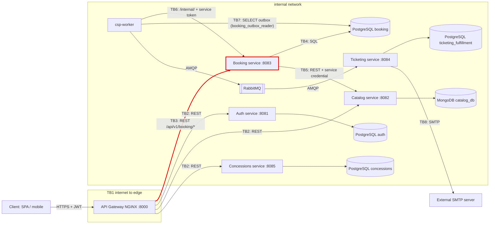

# 01 - Attack surface and trust boundaries (CineSync Platform)

My boundary: **TB3, API Gateway to Booking service** (claim issue: code-corhuila/csp-docs#274).

## Data-flow diagram

Trust boundaries: TB1 internet to Gateway; TB2 Gateway to Auth, Catalog and Concessions;
**TB3 Gateway to Booking (mine)**; TB4 Booking to its database; TB5 Booking to Catalog;
TB6 csp-worker to Booking internal routes; TB7 csp-worker to the Booking outbox;
TB8 Ticketing to the external SMTP server.

## Assets

| Asset | Where it lives | Classification |
|---|---|---|
| Access token (JWT RS256) | Client, `Authorization` header through the Gateway, validated in Booking | Restricted |
| Service token for `/internal/` routes | csp-worker and workflow service, sent to Booking | Restricted |
| Reservation (`reservation`, `total_amount` in cents, user id) | PostgreSQL `booking` | Confidential |
| Seat hold and held seats (`seat_hold`, `seat_hold_item`, TTL) | PostgreSQL `booking` | Internal |
| `Idempotency-Key` and stored response of `POST /holds` | PostgreSQL `booking` | Confidential |
| Event `BookingConfirmed.v1` in `booking.outbox_event` | PostgreSQL `booking`, then RabbitMQ | Confidential |
| Seat map of a showtime (`GET /showtimes/{showtimeId}/seats`) | Booking, snapshot from Catalog | Public |

## Entry points of TB3 (Gateway to Booking, base path `/api/v1/booking`)

| Entry point | Called by | Authentication today |
|---|---|---|
| `POST /holds` | Client through the Gateway | `Authorization` header must exist at the Gateway; Booking validates the RS256 JWT and requires `Idempotency-Key` |
| `GET /reservations` | Client through the Gateway | Same as above; returns only the caller's reservations |
| `GET /reservations/{reservationId}` | Client through the Gateway | Same as above |
| `POST /reservations/{reservationId}/confirm` | Client through the Gateway | Same as above |
| `GET /showtimes/{showtimeId}/seats` | Client through the Gateway | Same as above |
| `GET /health`, `GET /health/ready` | Gateway and platform health checks | None (`/health` has no dependencies; `/health/ready` checks PostgreSQL only) |
| `POST /internal/workflow/holds`, `.../reservations/{reservationId}/confirm`, `.../release` | Workflow service | Service token, subject in `WORKFLOW_SUBJECTS`; not meant to be routed by the Gateway |
| `POST /internal/maintenance/expire-holds`, `/purge` | csp-worker | Service token, subject in `SERVICE_SUBJECTS`; not routed by the Gateway |

Controls at the Gateway today (ADR-028): presence filter of `Authorization` (it does not validate the
JWT), stateless per-IP rate limiting with `limit_req`, and `X-Correlation-Id` propagation.
