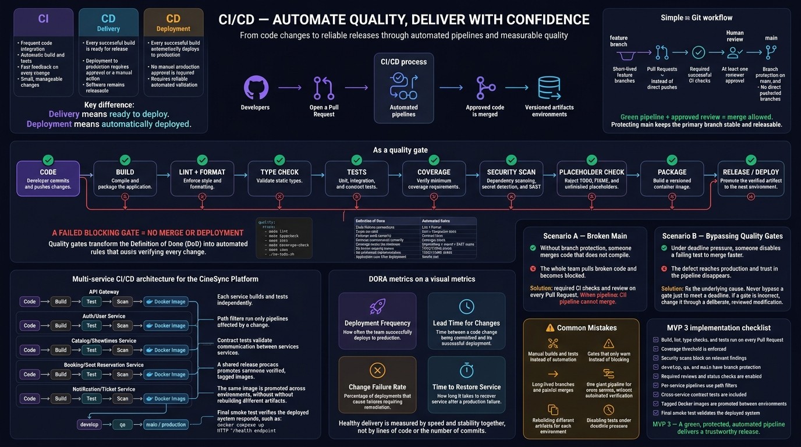

<!-- HU-STATUS TEMPLATE - do NOT remove the <!-- ... --> markers or the table headers.
     Your weekly grade is read AUTOMATICALLY from this file:
       14-week/hu-status/README.md  (inside YOUR fork). English. -->

# Weekly Status - Week 14

<!-- CONFIG-START - must match your profile repo (username/username) CONFIG -->
- FULL_NAME: Yeferson Esmid Heredia Perdomo
- GITHUB_USER: Yefersom10
- TEAM: CineSync Platform
- SPRINT_GOAL: Turn the threat-model workshop into code (the three Booking security stories), promote the Concessions stories HU-CONCESSIONS-004, 005 and 007 to qa, remove the sample data from the Booking portal, and merge the STRIDE threat model of the Gateway to Booking boundary.
<!-- CONFIG-END -->

## 1. User stories worked this week
| HU ID | Title | Status (todo/doing/done) | Evidence (PR or commit URL) |
|---|---|---|---|
| [security] D (csp-docs#283) | One user cannot hold unlimited seats of a showtime | done | Issue [#283](https://github.com/code-corhuila/csp-docs/issues/283) closed 2026-11-05 · [csp-booking-api#77](https://github.com/code-corhuila/csp-booking-api/pull/77) (promoted in #78) · [csp-docs#331](https://github.com/code-corhuila/csp-docs/pull/331) |
| [security] S (csp-docs#284) | A stolen or revoked access token stops working quickly | done | Issue [#284](https://github.com/code-corhuila/csp-docs/issues/284) closed 2026-11-05 · [csp-booking-api#79](https://github.com/code-corhuila/csp-booking-api/pull/79) (promoted in #80) |
| [security] E (csp-docs#285) | Internal workflow routes accept only genuine service tokens | done | Issue [#285](https://github.com/code-corhuila/csp-docs/issues/285) closed 2026-11-05 · [csp-booking-api#81](https://github.com/code-corhuila/csp-booking-api/pull/81) (promoted in #82) · [#72](https://github.com/code-corhuila/csp-booking-api/pull/72), [#75](https://github.com/code-corhuila/csp-booking-api/pull/75) |
| Threat model | STRIDE of the boundary API Gateway to Booking service | done | [csp-docs#277](https://github.com/code-corhuila/csp-docs/pull/277) merged 2026-11-09 00:36 UTC (Sun 8 Nov, Colombia); claim issue [#274](https://github.com/code-corhuila/csp-docs/issues/274) closed |
| HU-CATALOG-005 | Booking validates seats against the Catalog layout | done | [csp-booking-api#71](https://github.com/code-corhuila/csp-booking-api/pull/71) merged 2026-11-04 (promoted in #74) |
| HU-CONCESSIONS-004, 005, 007 | Orders, idempotent inbox and stock movement history | done (qa) | HU-005: [db#12](https://github.com/code-corhuila/csp-concessions-db/pull/12), [#13](https://github.com/code-corhuila/csp-concessions-db/pull/13) · [api#44](https://github.com/code-corhuila/csp-concessions-api/pull/44), [#45](https://github.com/code-corhuila/csp-concessions-api/pull/45) · [worker#64](https://github.com/code-corhuila/csp-worker/pull/64), [#65](https://github.com/code-corhuila/csp-worker/pull/65) · HU-007: [api#49](https://github.com/code-corhuila/csp-concessions-api/pull/49) · HU-004 promoted to qa: [db#11](https://github.com/code-corhuila/csp-concessions-db/pull/11) |
| Booking portal | End of the sample data in the list and the admin view | done | [csp-booking-portal#82](https://github.com/code-corhuila/csp-booking-portal/pull/82) to [#88](https://github.com/code-corhuila/csp-booking-portal/pull/88) · CORS regex anchored [#89](https://github.com/code-corhuila/csp-booking-portal/pull/89), [#90](https://github.com/code-corhuila/csp-booking-portal/pull/90) |
| Release 3.0.0 (Booking, Concessions) | Keep the release branches current | doing | Open, `REVIEW_REQUIRED`: [booking-db#43](https://github.com/code-corhuila/csp-booking-db/pull/43), [booking-api#61](https://github.com/code-corhuila/csp-booking-api/pull/61), [booking-portal#78](https://github.com/code-corhuila/csp-booking-portal/pull/78), [concessions-api#27](https://github.com/code-corhuila/csp-concessions-api/pull/27), [concessions-db#7](https://github.com/code-corhuila/csp-concessions-db/pull/7) |

## 2. My individual contribution
- **Security, from the workshop to code:** the three stories of the threat model are closed in code: seat cap per user ([api#77](https://github.com/code-corhuila/csp-booking-api/pull/77)), rejection of access tokens that live longer than 15 minutes ([api#79](https://github.com/code-corhuila/csp-booking-api/pull/79)) and audit of every call to an internal route with a digest of the token ([api#81](https://github.com/code-corhuila/csp-booking-api/pull/81)), plus `iss` and `aud` required on service credentials ([api#72](https://github.com/code-corhuila/csp-booking-api/pull/72)) and service subjects through the compose ([api#75](https://github.com/code-corhuila/csp-booking-api/pull/75)). Documented in the contract and DEC-008 ([csp-docs#331](https://github.com/code-corhuila/csp-docs/pull/331)), with risk R-018 and its debt ([csp-docs#332](https://github.com/code-corhuila/csp-docs/pull/332), [#363](https://github.com/code-corhuila/csp-docs/pull/363)).
- **Concessions:** HU-CONCESSIONS-004 promoted to qa in api, worker and db; HU-CONCESSIONS-005 (inbox that applies each event id once) built and promoted in the three layers; HU-CONCESSIONS-007 promoted ([api#49](https://github.com/code-corhuila/csp-concessions-api/pull/49)).
- **Booking backend:** Catalog layout validation ([api#71](https://github.com/code-corhuila/csp-booking-api/pull/71)), token permissions and clock skew ([api#68](https://github.com/code-corhuila/csp-booking-api/pull/68), promoted in #73) and the Catalog client settings ([api#70](https://github.com/code-corhuila/csp-booking-api/pull/70)), each with its promotion to qa.
- **Booking portal:** the list and the admin view no longer show sample data and report "not available" on a server failure, with a test of the server error; the flow goes to the snacks step after the hold; the CORS origin regex is anchored.
- **Database and platform:** connection retry of the migration executor and documentation of `booking_migrator` ([booking-db#45](https://github.com/code-corhuila/csp-booking-db/pull/45), [#46](https://github.com/code-corhuila/csp-booking-db/pull/46)); Booking service-only configuration and metrics and alerts for the outbox relay ([csp-infra-postgres#49](https://github.com/code-corhuila/csp-infra-postgres/pull/49) to [#52](https://github.com/code-corhuila/csp-infra-postgres/pull/52)); health and readiness point of the worker ([csp-worker#66](https://github.com/code-corhuila/csp-worker/pull/66), [#67](https://github.com/code-corhuila/csp-worker/pull/67)).
- **Documentation in csp-docs:** status and delivery trail of Concessions, test figures, recovery notes of the inbox, manuals (seat limits, token lifetime, local validation, screenshots of the Booking flow), closure of TD-053 and update of R-018 ([csp-docs#363](https://github.com/code-corhuila/csp-docs/pull/363) to [#367](https://github.com/code-corhuila/csp-docs/pull/367)).
- **PR breakdown (60 PRs created in the UTC window, all merged, 0 closed without merging):** 34 are my own feature, fix, test and docs PRs and 26 are promotions to qa, changelogs and releases. Nine of the 60 were opened on the evening of Sunday 1 Nov in Colombia, so by local time 51 belong to this week (33 own, 18 promotions). Classified by title.
- **Volume:** 154 commits listed in [git_commits.md](./git_commits.md): 115 merged in `code-corhuila`, 21 of mine on the open release 3.0.0 branches and 18 in my fork. The fork commits belong to a personal certification study log (`certification/`) and are not part of the CI/CD class activity. Twelve `csp-docs` commits and four fork commits dated 2026-11-09 UTC were made on the evening of Sunday 8 Nov in Colombia.
- **Ceremonies:** no planning, daily, review or retro minutes exist for this week.
- **No activity** this week in the Ticketing repositories, `csp-workflow`, `csp-infra-rustfs`, `csp-infra-rabbitmq`, `csp-api-gateway`, `csp-front`, `csp-auth-*` or `csp-catalog-*`.

## 3. Blockers and risks
- **GitHub Actions is still locked by billing.** The latest job checked (csp-worker, run 42538478167, 2026-11-09 00:07 UTC) fails with 0 steps and the message "your account is locked due to a billing issue". Every CI run of my code repositories in the window failed, so the 60 PRs merged without a green CI; they were validated locally. In `csp-docs` there are 60 `startup_failure` runs with no stated cause.
- **The five release 3.0.0 PRs are still open with `REVIEW_REQUIRED` and no approval.** Their branches keep receiving commits while they wait.
- **PR csp-docs#277 was merged without formal approvals:** the three reviews (Oscarsl10, karencaicedo1907, nicolas1250) are comments, not approvals.
- The board has no card for the security workshop week (#274, #277), and the status of HU-CONCESSIONS-006 was not checked this week.
- Class sessions 1 and 2 (CI/CD, pipelines and quality gates): I did not build a new pipeline or quality gate this week; the only related material is the local validation guide ([csp-docs#364](https://github.com/code-corhuila/csp-docs/pull/364), [#367](https://github.com/code-corhuila/csp-docs/pull/367)) and the notes about the Actions lock.

## 4. Plan for next week
- Get the review of the professor and the leader for the five release 3.0.0 PRs, and merge them in order (database, API, portal) once approved.
- Check the status of HU-CONCESSIONS-006 and move the Concessions stories from qa toward main.
- Pipeline and gates: write a short plan for the first two CI gates (coverage floor and dependency scan) for Booking, to be run when Actions is available again, and record real ceremony minutes (planning, review, retro) in `csp-docs`.

## 5. Compliance self-check
- [x] Conventional Commits - `type(scope): summary`
- [x] Per-environment HU branch + PR to that environment (hu-xxx-dev -> develop, ...)
- [x] Testable acceptance criteria
- [x] Tests added/updated (unit / integration)
- [x] DDD / hexagonal boundaries respected (domain has no I/O)
- [x] No secrets; config via environment variables

## 6. Evidence links
- Full commit list of the week: [git_commits.md](./git_commits.md)
- Threat model merged: https://github.com/code-corhuila/csp-docs/pull/277
- Security stories in code: https://github.com/code-corhuila/csp-booking-api/pull/77 · https://github.com/code-corhuila/csp-booking-api/pull/79 · https://github.com/code-corhuila/csp-booking-api/pull/81
- Concessions inbox (HU-CONCESSIONS-005): https://github.com/code-corhuila/csp-concessions-db/pull/12 · https://github.com/code-corhuila/csp-concessions-api/pull/44 · https://github.com/code-corhuila/csp-worker/pull/64
- Release 3.0.0 PRs (open): https://github.com/code-corhuila/csp-booking-db/pull/43 · https://github.com/code-corhuila/csp-booking-api/pull/61 · https://github.com/code-corhuila/csp-booking-portal/pull/78 · https://github.com/code-corhuila/csp-concessions-api/pull/27 · https://github.com/code-corhuila/csp-concessions-db/pull/7
- Class Material - CI/CD, pipelines and quality gates:

